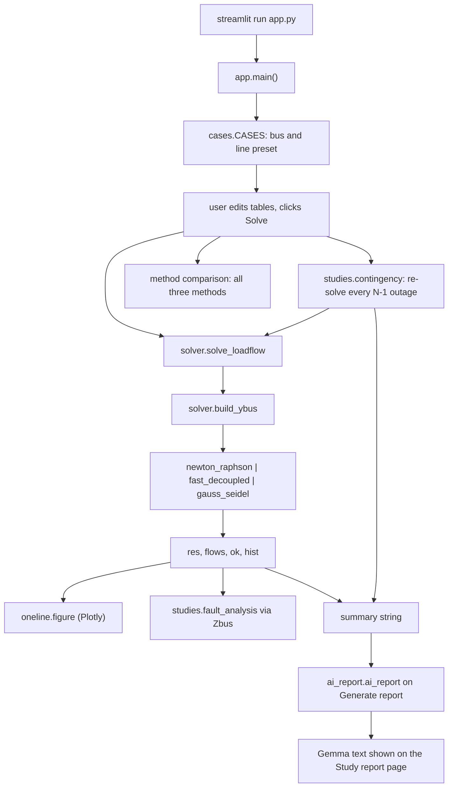

# CAPSA — Power System Analysis

A Python tool that solves an N-bus power system and turns the results into something readable: load flow by three classical methods, an N-1 contingency sweep, a three-phase fault study, and plots plus a plain-English summary. It was built for Hacktoberfest and uses only open-source libraries and open-weight models: the solver does every calculation, and a local Gemma model served by LM Studio only explains the numbers it is given.

## Features

- Three load flow methods: Newton-Raphson, Fast Decoupled (XB), Gauss-Seidel.
- Two editable presets: 5-bus demo and IEEE 14-bus.
- N-1 contingency sweep: each line removed in turn, case re-solved, ranked worst-first.
- Three-phase fault analysis at every bus via the Zbus matrix.
- One-line diagram in the style of planning tools (bus bars, generator and load symbols, voltage-band colouring, MW on each branch), plus voltage-profile and post-fault charts.
- Report-style output: bus report (V, angle, P/Q generation and load in MW/MVAr), branch report (sending/receiving-end flows and losses), N-1 limit violation report.
- Method comparison table (convergence, iterations, loss, minimum voltage).
- **Voltage stability (P-V curves)**: every load and generator is scaled by λ until the load flow stops solving; reports the loadability margin, the weakest bus and the first λ that breaks Vmin.
- **Contingency explorer**: pick any line outage, see the network redrawn with that line tripped, post-outage voltages, and the MW flow redistribution on every remaining line.
- Optional report written by a local Gemma model via LM Studio, given only the solver's numbers.
- Three sidebar modes (Quick, Standard, Advanced) so nobody has to fill every field; untouched settings fall back to defaults.
- Grid data loads three ways: preset case, uploaded bus/line CSV pair (blank templates included), or direct table edits.
- Optional columns: transformer taps (`Tap`) and bus shunts (`Bs`) appear only when ticked; `Tap = 1`, `Bs = 0` and missing `B` are filled automatically before solving.
- Every study runs on **Run study** and has its own page (Dashboard, Network diagram, Solver check, Contingency N-1, PV analysis, Fault levels, Study report), each with its own URL and an "Open in new tab" link. Results are cached, so a page opened in a new browser tab shows the last solved study without re-running.
- Interactive one-line diagram (Plotly): wheel zoom, drag pan, hover for P/Q/S per line and per bus, click a bus or line to inspect it; optional flow, angle, load, generator and breaker layers. Optional bus columns `x`, `y` override the layout.
- Pre-solve validation with friendly, specific errors (slack count, lines to missing buses, `X = 0`, disconnected network, bad numbers).
- Export: the Study report page downloads the generated report as Markdown.

## Project structure

```
CAPSA/
├── app.py                 Streamlit GUI: pages, modes, dynamic inputs, validation, cached studies
├── theme.css              the dark palette and all styling as CSS variables
├── ui_theme.py            loads theme.css: palette, CSS injection, banner/badges/status bar, matplotlib + Plotly style
├── oneline.py             interactive single-line diagram (Plotly): layout, routing, hover, inspector data
├── solver.py              METHODS, build_ybus, injections, the three solvers, solve_loadflow
├── cases.py               _bus/_lines helpers, the CASES presets and their diagram COORDS
├── studies.py             contingency (N-1), outage, pv_curve, fault_analysis (3-phase via Zbus)
├── plotting.py            voltage-profile / convergence / P-V / post-fault figures (matplotlib)
├── ai_report.py           LMSTUDIO_URL, lm_models, ai_report (local Gemma via LM Studio)
├── check_refactor.py      asserts the split modules match power_flow_methods.py exactly
├── power_flow_methods.py  the original single-file version, kept as the comparison baseline
├── requirements.txt       numpy, pandas, matplotlib, plotly, streamlit, requests, pytest
├── run.sh                 convenience wrapper around streamlit run app.py
├── AGENTS.md              contributor notes and conventions
└── venv/                  local virtual environment (managed with uv)
```

## Execution flow

1. `streamlit run app.py` imports the modules and calls `main()` in `app.py`; `ui_theme.inject()` applies the dark theme CSS and the matplotlib/Plotly styles; `st.navigation` builds the page list; the banner and status bar render on every page.
2. The sidebar mode selector stages the inputs: **Quick** shows only the case source (preset or CSV upload); **Standard** adds the method, Base MVA and voltage limits; **Advanced** adds the transformer-tap and shunt-columns toggles and the solver tolerance. Every input carries a `help=` tooltip with its unit.
3. The bus and line tables are `st.data_editor`s over `st.session_state["bus_tbl"]` / `["lines_tbl"]`, seeded from the preset (`cases.py`), replaced by `pd.read_csv` on upload, and edited in place. Hidden `Tap`/`Bs` columns keep their data; `_prep()` fills `Tap = 1`, `Bs = 0` and missing `B` before the solver sees the tables.
4. Pressing **Run study** (Dashboard, below the case tables) validates first (`_prep` returns friendly problems for a wrong slack count, lines to missing buses, `X = 0`, disconnected networks and non-numeric cells) — on success it calls `solve_loadflow(bus, lines, method, tol)` (`solver.py`), which builds the admittance matrix with `build_ybus`, flat-starts the PQ voltages, dispatches to `newton_raphson`, `fast_decoupled` or `gauss_seidel`, then computes bus injections and per-line flows, returning `(res, flows, ok, hist)`.
5. All studies run on the same click inside `_study()` (cached with `st.cache_data` on the case and settings): the method-comparison loop, `contingency(bus, lines, vmin, vmax)` and `pv_curve` (`studies.py`). Results and a summary string are stored in `st.session_state["out"]`, and the last solved inputs in a server-wide `st.cache_resource` store so a new browser tab restores them.
6. The Dashboard renders status badges, six metric cards and the bus/branch tables with the voltage-profile/convergence figures. The Network diagram page draws `oneline.figure(...)` with an inspector panel; the Solver check and N-1 pages show their tables (the N-1 explorer redraws the diagram with the line tripped); the Fault levels page calls `fault_analysis(bus, lines, res, xd, zf, base, kv)` (`studies.py`) with its own Xd'', Zf and base-kV inputs and plots post-fault voltages; the Study report page lists LM Studio models.
7. On the Study report page, `lm_models()` (`ai_report.py`) lists the models loaded in LM Studio. **Generate report** calls `ai_report(summary, model)`, which posts the summary to the LM Studio chat endpoint; the model phrases the numbers, it does not compute them.
8. The Study report page has a single **Download study report** button (Markdown), disabled until a report exists.



## Where to look when debugging

| Symptom | File |
| --- | --- |
| Wrong bus voltages, angles, flows or losses | `solver.py` (`build_ybus`, the method functions, `solve_loadflow`) |
| Convergence flag or iteration counts look off | `solver.py` (convergence history handling) |
| N-1 table wrong or full of FAILED rows | `studies.py` (`contingency`) |
| Fault currents or kA numbers wrong | `studies.py` (`fault_analysis`), base kV input in `app.py` |
| One-line diagram layout, hover or click broken | `oneline.py` (`layout`, `figure`, `inspect`), `cases.COORDS` |
| Profile / history / P-V / fault figures broken | `plotting.py` |
| Theme, banner, badges or metric cards look wrong | `theme.css`, `ui_theme.py` (`inject`, `mpl_style`, `plotly_style`), `.streamlit/config.toml` |
| Report fails, or no models listed | `ai_report.py` (`lm_models`, `ai_report`); check LM Studio on port 1234 |
| Pages, editors or cached results misbehave | `app.py` (`main`, `_page`, `_study`) |

## Setup and run

```
uv pip install -r requirements.txt      # or: pip install -r requirements.txt
./run.sh                                # or: streamlit run app.py
```

`run.sh` just runs `venv/bin/streamlit run app.py`, so it works without activating the virtual environment.

The AI report needs LM Studio: open the Developer tab, load a Gemma model, click Start Server (port 1234). `lm_models` reads the loaded models from that server, so no model id is hardcoded. LM Studio is only needed for the AI report tab — everything else runs without it.

## Data format

Everything is per unit on the Base MVA from the sidebar.

`Tap` and `Bs` are optional UI columns (Advanced-mode toggles). When a toggle is off the column is hidden in the table but its data is kept; `_prep()` in `app.py` fills `Tap = 1` (or `Bs = 0`) before solving, and missing `B` values become `0`.

Bus table:

| Column | Meaning |
| --- | --- |
| `Type` | `Slack`, `PV` or `PQ` (exactly one Slack bus) |
| `V` | Voltage setpoint (Slack and PV), initial guess for PQ |
| `Pg`, `Qg` | Generator injection |
| `Pd`, `Qd` | Load |
| `Bs` | Shunt susceptance |

Line table:

| Column | Meaning |
| --- | --- |
| `From`, `To` | 1-based bus numbers |
| `R`, `X` | Series resistance and reactance |
| `B` | Total line charging susceptance, split B/2 at each end |
| `Tap` | Off-nominal tap ratio, 1 = none |

Results: `res` has `Bus`, `V (pu)`, `Angle (deg)`, `P_inj`, `Q_inj`; `flows` has `From`, `To`, `P_ij`, `Q_ij`, `P_ji`, `Q_ji`, `Loss_P`, `Loss_Q`. For `solve_loadflow`, `len(hist) - 1` is the iteration count.

## Testing

- `./venv/bin/python check_refactor.py` — the refactor check. It compares the moved function source text, the `CASES` tables, `build_ybus`, `solve_loadflow` for all three methods on both cases, `contingency` and `fault_analysis` against `power_flow_methods.py` and asserts they are exactly identical. Note: that baseline file is currently commented out from top to bottom, so the script stops at import until the original code is restored.
- `pytest` is listed in `requirements.txt` and installed, but the repository has no test files yet, so `pytest` currently collects nothing.

## Limitations

- No generator reactive-power limits and no PV-to-PQ switching when a PV bus hits its Q limit.
- Fault analysis uses a single base kV (`kv` input) for all buses, so the kA column is wrong on multi-voltage cases such as IEEE 14-bus.
- Newton-Raphson uses a central-difference numerical Jacobian, which is slower than an analytical one on large cases.
- Gauss-Seidel is called without the `tol` argument inside `solve_loadflow`, so it always runs with its own default tolerance and the method comparison is not exactly at one shared tolerance.

## License and credits

Placeholder: license TBD. Built with numpy, pandas, matplotlib, plotly and streamlit, with the AI report generated by a local Gemma model via LM Studio.
