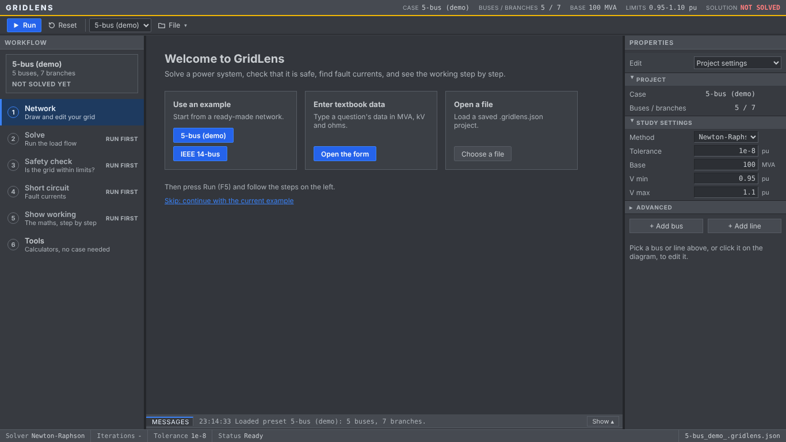
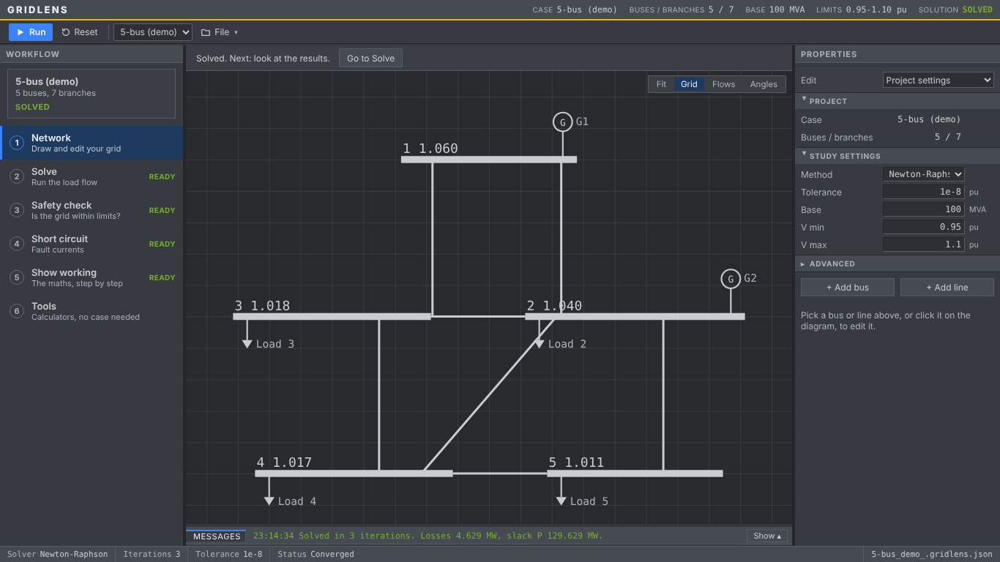
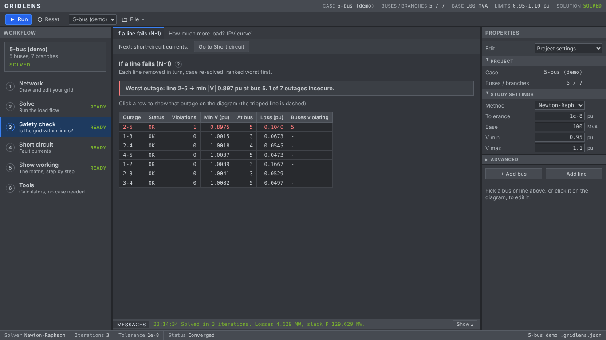

# CAPSA — Power System Analysis

A Python tool that solves an N-bus power system and turns the results into something readable: load flow by three classical methods, an N-1 contingency sweep, a three-phase fault study, and plots plus a plain-English summary. It was built for Hacktoberfest and uses only open-source libraries and open-weight models: the solver does every calculation, and a local Gemma model served by LM Studio only explains the numbers it is given.

## Features

- Three load flow methods: Newton-Raphson, Fast Decoupled (XB), Gauss-Seidel.
- **Any network** (v1.6): start a blank case and draw it or fill in the tables, in per unit or in actual units (MW, MVAr, kV, Ω, µS); import MATPOWER `.m`, IEEE common data format and CSV files. The 5-bus demo and IEEE 14-bus are examples in the File menu.
- N-1 contingency sweep: each line removed in turn, case re-solved, ranked worst-first. An outage that cuts buses off from every Slack solves the rest and reports the load lost (v2.5).
- Three-phase fault analysis at every bus via the Zbus matrix.
- One-line diagram in the style of planning tools (bus bars, generator and load symbols, voltage-band colouring, MW on each branch), plus voltage-profile and post-fault charts.
- Report-style output: bus report (V, angle, P/Q generation and load in MW/MVAr), branch report (sending/receiving-end flows and losses), N-1 limit violation report.
- Method comparison table (convergence, iterations, loss, minimum voltage).
- **Voltage stability (P-V curves)**: every load and generator is scaled by λ until the load flow stops solving; reports the loadability margin, the weakest bus and the first λ that breaks Vmin.
- **Contingency explorer**: pick any line outage, see the network redrawn with that line tripped, post-outage voltages, and the MW flow redistribution on every remaining line.
- Optional report written by a local Gemma model via LM Studio, given only the solver's numbers.
- Three sidebar modes (Quick, Standard, Advanced) so nobody has to fill every field; untouched settings fall back to defaults.
- Grid data loads three ways: preset case, uploaded bus/line CSV pair (blank templates included), or direct table edits.
- Optional columns: transformer taps (`Tap`) and bus shunts (`Bs`) appear only when ticked; `Tap = 1`, `Bs = 0` and missing `B` are filled automatically before solving.
- Every study runs on **Run study** and has its own page (Dashboard, Network diagram, Solver check, Contingency N-1, PV analysis, Fault levels, Study report), each with its own URL and an "Open in new tab" link. Results are cached, so a page opened in a new browser tab shows the last solved study without re-running.
- Interactive one-line diagram (Plotly): wheel zoom, drag pan, hover for P/Q/S per line and per bus, click a bus or line to inspect it; optional flow, angle, load, generator and breaker layers. Optional bus columns `x`, `y` override the layout.
- Pre-solve validation with friendly, specific errors (slack count, lines to missing buses, zero impedance R = X = 0, disconnected network, bad numbers). Series capacitors (negative X) are accepted since v2.3, so MATPOWER's case300 loads.
- Export: the Study report page downloads the generated report as Markdown.

### Textbook problems (v1.2)

For Saadat / Grainger & Stevenson / Kothari & Nagrath style questions, with the working shown:

- **Problem input**: enter data in real units (system MVA, base kV, Ω or Ω/km × length, µS, µS/km or charging MVAr, MW/MVAr loads, generator MW and |V|, transformer % on own rating). Base kV zones follow the transformer ratios; the page lists every per-unit conversion, then **Load into study**.
- **Generator Q limits** (Advanced → Study settings, off by default): a PV bus outside Qmin/Qmax becomes PQ at the limit, with a switching log.
- **Ybus matrix**: rectangular and polar, plus the terms that form each element (series y, y/a, y/a², jB/2, shunts).
- **Iterations**: Gauss-Seidel voltages per iteration (acceleration factor α), Newton-Raphson mismatch vector, J1–J4 and corrections per iteration, Fast Decoupled B′ and B″.
- **Worked answer**: textbook-style bus results, slack power, line flows and losses, and a copyable plain-text answer (given data → per unit → Ybus → iterations → results).
- **Unsymmetrical faults**: 3-phase, SLG, LL, DLG through Zf using sequence Zbus with generator / transformer winding connections (Yg, Y, Δ); sequence and phase voltages at every bus, sequence currents in branches, kA from each bus's own base kV.
- **Economic dispatch**: λ iteration with quadratic costs, unit limits and B-coefficient losses (penalty factors).
- **Symmetrical components** and **Line parameters** (short / medium-π / long ABCD, regulation, efficiency, SIL) calculators.
- Pages are grouped (Load flow, Worked solution, Studies, Calculators, Report); every results page has **Re-run study**, and the header shows amber **STALE** when the case or settings changed since the last run.

## Project structure

```
GridLens/
├── app.py          Streamlit GUI: pages, modes, inputs, cached studies
├── ui.py           Streamlit helpers and pages: HTML helpers, editable tables, Problem input,
│                   textbook topic pages, worked-solution pages (Ybus, Iterations, Worked answer)
├── figures.py      palette from theme.css, matplotlib / Plotly styles, charts, the one-line diagram
├── solver.py       METHODS, sparse Ybus, Newton-Raphson (v2.1) and Fast Decoupled (v2.2), dense
│                   build_ybus and Gauss-Seidel (teaching), solve_loadflow, DC load flow,
│                   PV -> PQ Q limits
├── studies.py      contingency (N-1), outage, pv_curve, fault_analysis (3-phase via Zbus)
├── working.py      Ybus terms, traced GS / NR (analytical J1..J4) / FD, worked-answer text
├── topics.py       textbook calculators: symmetrical components, line ABCD, sequence faults
│                   (SLG / LL / DLG), economic dispatch, real units -> per unit
├── model.py        element model (v2.4): bus, branch, gen, load, shunt tables with stable ids,
│                   v1 table converters, results keyed by id
├── gridcore.py     validation (prep_case, islands), loadflow (fallback + failure hints), run_study,
│                   outage, line loading, the example cases, LM Studio report
├── jobs.py         background jobs (v2.8): long work on its own thread, progress, cancel
├── formats.py      case file readers: MATPOWER .m, IEEE common data format, CSV templates
├── theme.css       the dark palette and all styling as CSS variables
├── api/            FastAPI server (JSON over the modules above); docs at /docs
├── web/            PSCAD-style workspace (Vite + TypeScript + D3), 8 files in web/src
├── tools/          names.py, check_contrast.py, sync_tokens.py, shots.py
├── legacy/         the original single-file version and its comparison script (reference only)
├── tests/          pytest suite
├── requirements.txt  numpy, pandas, matplotlib, plotly, streamlit, requests, fastapi, httpx, pytest
├── run.sh · run_api.sh · run_workspace.sh   start the Streamlit app / the API / the workspace
└── AGENTS.md       contributor notes and conventions
```

## Execution flow

1. `streamlit run app.py` imports the modules and calls `main()` in `app.py`; `ui.inject()` applies the dark theme CSS and the matplotlib/Plotly styles; `st.navigation` builds the page list; the banner and status bar render on every page.
2. The sidebar mode selector stages the inputs: **Quick** shows only the case source (preset or CSV upload); **Standard** adds a collapsible **Study settings** group with the method, Base MVA and voltage limits; **Advanced** adds the transformer-tap, shunt and generator-Q-limit toggles and the solver tolerance to it. Every input carries a `help=` tooltip with its unit. Base MVA is kept in `_base`, so a case loaded from Problem input brings its own base.
3. The bus and line tables are `st.data_editor`s over `st.session_state["bus_tbl"]` / `["lines_tbl"]`, seeded from the preset (`gridcore.py`), replaced by `pd.read_csv` on upload, and edited in place. Hidden `Tap`/`Bs` columns keep their data; `_prep()` fills `Tap = 1`, `Bs = 0` and missing `B` before the solver sees the tables.
4. Pressing **Run study** (Dashboard, below the case tables) validates first (`_prep` returns friendly problems for a wrong slack count, lines to missing buses, `X = 0`, disconnected networks and non-numeric cells) — on success it calls `solve_loadflow(bus, lines, method, tol)` (`solver.py`), which builds the admittance matrix with `build_ybus`, flat-starts the PQ voltages, dispatches to `newton_raphson`, `fast_decoupled` or `gauss_seidel`, then computes bus injections and per-line flows, returning `(res, flows, ok, hist)`.
5. All studies run on the same click inside `_study()` (cached with `st.cache_data` on the case and settings): the method-comparison loop, `contingency(bus, lines, vmin, vmax)` and `pv_curve` (`studies.py`). Results and a summary string are stored in `st.session_state["out"]`, and the last solved inputs in a server-wide `st.cache_resource` store so a new browser tab restores them.
6. The Dashboard renders status badges, six metric cards and the bus/branch tables with the voltage-profile/convergence figures. The Network diagram page draws `figures.figure(...)` with an inspector panel; the Solver check and N-1 pages show their tables (the N-1 explorer redraws the diagram with the line tripped); the Fault levels page calls `fault_analysis(bus, lines, res, xd, zf, base, kv)` (`studies.py`) with its own Xd'', Zf and base-kV inputs and plots post-fault voltages; the Study report page lists LM Studio models.
7. On the Study report page, `lm_models()` (`gridcore.py`) lists the models loaded in LM Studio. **Generate report** calls `ai_report(summary, model)`, which posts the summary to the LM Studio chat endpoint; the model phrases the numbers, it does not compute them.
8. The Study report page has a single **Download study report** button (Markdown), disabled until a report exists.
9. The worked-solution pages (`ui.py`) recompute from the solved case with `working.py`, which repeats the solver's formulas while recording every step (tests check each trace ends on the solver's answer). The topic pages (`ui_topics.py`) call `seqfaults.py`, `dispatch.py`, `symcomp.py` and `tline.py`; dispatch, symmetrical components and line parameters need no solved case.


## Where to look when debugging

| Symptom | File |
| --- | --- |
| Wrong bus voltages, angles, flows or losses | `solver.py` (`build_ybus`, the method functions, `solve_loadflow`) |
| Convergence flag or iteration counts look off | `solver.py` (convergence history handling) |
| N-1 table wrong or full of FAILED rows | `studies.py` (`contingency`) |
| Fault currents or kA numbers wrong | `studies.py` (`fault_analysis`), base kV input in `app.py` |
| One-line diagram layout, hover or click broken | `figures.py` (`layout`; `_layered` for small networks, `_stress_rows` + `_straight` above 24 buses), `web/src/canvas.ts` |
| An imported file reads wrong | `formats.py` (`read_matpower`, `read_cdf`, `read_csv`) |
| Actual-unit case converts wrong | `topics.py` (`case_to_pu`) |
| "Did not converge" hint or fallback wrong | `gridcore.py` (`loadflow`, `ATTEMPTS`, `failure_hint`) |
| Islands or validation messages wrong | `gridcore.py` (`prep_case`, `_islands`) |
| Profile / history / P-V / fault figures broken | `figures.py` |
| Theme, banner, badges or metric cards look wrong | `theme.css`, `ui.py` (`inject`), `figures.py` (`mpl_style`, `plotly_style`), `.streamlit/config.toml` |
| Report fails, or no models listed | `gridcore.py` (`lm_models`, `ai_report`); check LM Studio on port 1234 |
| Pages, editors or cached results misbehave | `app.py` (`main`, `_page`, `_study`) |
| Per-unit conversion or zones wrong | `topics.py` (`zones`, `to_pu`) |
| PV -> PQ switching wrong | `solver.py` (`solve_with_qlimits`) |
| Ybus breakdown, iteration tables or worked answer wrong | `working.py` |
| Sequence fault currents / voltages wrong | `topics.py` (`seq_ybus`, `fault_currents`, `solve_fault`) |
| Dispatch, symmetrical components or line results wrong | `topics.py` (dispatch, symcomp, tline sections) |

## Setup and run

```
uv pip install -r requirements.txt      # or: pip install -r requirements.txt
./run.sh                                # or: streamlit run app.py
```

`run.sh` just runs `venv/bin/streamlit run app.py`, so it works without activating the virtual environment.

The AI report needs LM Studio: open the Developer tab, load a Gemma model, click Start Server (port 1234). `lm_models` reads the loaded models from that server, so no model id is hardcoded. LM Studio is only needed for the AI report tab — everything else runs without it.

## Data format

Everything is per unit on the Base MVA from the sidebar.

`Tap` and `Bs` are optional UI columns (Advanced-mode toggles). When a toggle is off the column is hidden in the table but its data is kept; `_prep()` in `app.py` fills `Tap = 1` (or `Bs = 0`) before solving, and missing `B` values become `0`.

Bus table:

| Column | Meaning |
| --- | --- |
| `Type` | `Slack`, `PV` or `PQ` (exactly one Slack bus) |
| `V` | Voltage setpoint (Slack and PV), initial guess for PQ |
| `Pg`, `Qg` | Generator injection |
| `Pd`, `Qd` | Load |
| `Bs`, `Gs` | Shunt susceptance and conductance (per unit, or MVAr / MW at 1 pu in actual units) |
| `Num`, `Name` | Optional label: the bus number from the file / book, and a name (lines still refer to rows 1..N) |
| `Va` | Optional angle (deg): the Slack's reference angle, and the start for the set-point initial guess |
| `Qmin`, `Qmax` | Optional generator Q limits (shown and used with Generator Q limits on) |
| `kV` | Optional base kV (filled by Problem input; used for kA on the Unsymmetrical faults page) |
| `x`, `y` | Optional one-line diagram position (y grows downward) |

Line table:

| Column | Meaning |
| --- | --- |
| `From`, `To` | 1-based bus numbers |
| `R`, `X` | Series resistance and reactance |
| `B` | Total line charging susceptance, split B/2 at each end |
| `Tap` | Off-nominal tap ratio, 1 = none |
| `Shift` | Optional phase shift (deg) at the From side |
| `Rate` | Optional MVA rating (0 = none): loading % and N-1 overloads |
| `InService` | Optional: 0 / no = out of service (kept in the table, carries no flow) |
| `Kind` | Optional `line` or `trafo` (drawing symbol; the maths uses Tap and Shift) |

With case setting `units = actual`, bus powers are MW / MVAr, branch R and X are Ω (a transformer's referred to its From side) and B is µS, converted per unit on each From bus's base kV (`kV` is then required).

Problem input tables (real units) are documented at the top of `topics.py`: buses (MW, MVAr, |V|, Qmin/Qmax, shunt MVAr), lines (Ω or Ω/km with a length, B in µS, µS/km or total charging MVAr) and transformers (rated kV on both sides, MVA rating, R/X in pu on their own rating, tap at the From side).

Results: `res` has `Bus`, `V (pu)`, `Angle (deg)`, `P_inj`, `Q_inj`; `flows` has `From`, `To`, `P_ij`, `Q_ij`, `P_ji`, `Q_ji`, `Loss_P`, `Loss_Q`. For `solve_loadflow`, `len(hist) - 1` is the iteration count.

## Testing

- `legacy/check_refactor.py` compared the split modules with the original single file; `tests/test_core.py` (golden results) replaced it.
- `./venv/bin/python -m pytest` runs the suite in `tests/` (218 tests in v2.8). v2.8 adds `test_jobs.py`: a job reports its stage, count and time left and returns its result; Stop ends a running job at its next progress call and a queued one at once, and a job stuck in a long step does not hold up the next one of its kind; jobs of one kind run one at a time and oldest first, kinds in parallel; a failed job keeps its problems; only the last 8 finished jobs are kept; N-1, the P-V curve, the full study and the layout report progress without changing a number, and a cancel raised from progress is never counted as an outage that failed; `/api/jobs` returns exactly what `/api/study` and `/api/layout` return, refuses bad data before a job starts, and answers 404 for an unknown job. v2.7 adds the teaching-size limit (Gauss-Seidel and Show working only up to 30 buses; no dense Zbus in the fault answer above that). v2.6 adds `test_reference.py`: ten MATPOWER cases from case9 to case2383wp against MATPOWER's answers (AC voltages and angles, DC angles, every generator's P and Q; reference values from PYPOWER, see `tools/reference_pf.py`) and the phase 1 gate (case2383wp in under 1 s). v2.5 adds N-1 and the P-V curve with generator Q limits (a limit that binds only after an outage) and an outage that cuts off a bus with load (lost load, ranking, the rest equal to the case without it, the API's cut_off). v2.4 adds `test_model.py` (v1 tables -> element model -> v1 tables on six cases, the MATPOWER reader keeping all 33 generators of case24_ieee_rts, generator sharing against PYPOWER's runpf there, power balance and results that follow their ids after a branch is removed, id checks, JSON round trip). v2.3 adds negative X (a series capacitor cancels part of a line, NR and FD), a line with X = 0 (NR solves; FD and DC refuse it and the fallback moves on), the zero-impedance message and MATPOWER case300. v2.2 adds Fast Decoupled ending where Newton-Raphson does on case30 and case118, the DC load flow against closed forms (three-bus triangle; tap, phase shifter and shunt G) and its bus balance and islands. v2.1 adds `test_engine.py` (the sparse Ybus equals the dense one, including taps, phase shifters, out-of-service and parallel branches and shunts; the sparse Jacobian matches central differences on five cases; a singular step raises `LinAlgError`; case118 solves in 4 iterations). v1.6 adds `test_golden_api.py` (every study endpoint on both examples must return exactly what v1.5 returned), `test_anycase.py` (validation, islands, phase shifter, shunt G, in-service flags, fallback chain, failure hints, ratings, actual units, Saadat Example 6.7 entered in ohms and MW, tap transformer and Q-limited generator against closed forms) and `test_formats.py` (MATPOWER case9 and case14 against MATPOWER's published runpf answers, case118, IEEE CDF, CSV, big-network layout). Earlier tests: per-unit conversion and zones; Q limits (identical results when no limit binds, PV->PQ at Qmax); Ybus terms sum to `build_ybus` and Ybus is symmetric; the analytical Jacobian matches a numerical one; the GS (α = 1, exact), NR and FD traces end on `solve_loadflow`'s answer; GS/NR/FD agree within 1e-4 pu; SLG current = 3Vf/(Z1+Z2+Z0+3Zf), LL/DLG boundary conditions, Δ-Yg zero sequence, per-bus kA; symmetrical-component identities; dispatch (closed-form λ, limits, coordination equations with losses); ABCD reciprocity AD − BC = 1.
- `python tools/check_contrast.py` checks every text/background pair of the theme against WCAG AA (4.5:1).
- `python tools/walkthrough.py` (workspace running) clicks through every view, draws a network, and enters Saadat Example 6.7 from a blank case in ohms and MW; `python tools/shots.py` screenshots every view at 1366x768.

## Limitations

- Generator Q limits (optional) apply to the main load flow, N-1 and the P-V curve (since v2.5); the solver check compares the methods without them.
- The Streamlit app (`app.py`) keeps its v1.5 features; New case, actual units, file import and the new tables are in the web workspace only.
- Sequence networks are reactance-only and Δ-Y transformer phase shifts (30°) are not modelled.
- Since v2.1 Newton-Raphson is sparse with the analytical Jacobian: case2383wp (2,383 buses) solves in about 50 ms (Fast Decoupled, sparse since v2.2, in about 35 ms; the DC load flow in about 10 ms). The full study is still slow on big cases, because N-1 and the P-V curve re-solve once per outage and per step (Gauss-Seidel, a teaching method, is not run above 30 buses since v2.7): about 3 minutes on case2383wp. Since v2.8 it runs as a background job with progress and Stop; a faster N-1 is next in phase 2. The diagram layout of a big case without bus positions is slow too (about 2.5 minutes for case2383wp); since v2.8 it shows its progress and stops when another case is opened.

## License and credits

Placeholder: license TBD. Built with numpy, pandas, matplotlib, plotly and streamlit, with the AI report generated by a local Gemma model via LM Studio.


## Page layout (v1.3)

One main result per screen; detail sits behind tabs or pop-ups.

- Navigation is a top bar above the GRIDLENS header (Load flow, Worked solution, Studies, Calculators, Report). The sidebar holds only Mode and case selection.
- Dashboard: status badges, four cards, base-case voltage violations; Bus report, Branch report, Voltage profile and Convergence open in pop-ups. Case editors are in a collapsed expander.
- Contingency N-1: verdict line, then Ranking / Limit violations / Explorer tabs.
- Unsymmetrical faults: sequence data in a pop-up ("Edit sequence data", then Apply); results in Fault levels / Fault currents / Bus voltages / Branch currents tabs.
- Worked answer: slider and download in one row; Bus results / Line flows / Full written answer tabs.
- Problem input: the conversion checks (zone bases, per-unit table, solver case) are tabs under the input tables.

## JSON API (FastAPI)

`./run_api.sh` starts `uvicorn api.server:app` on port 8000; interactive docs at http://localhost:8000/docs. A case is `{"bus": [...], "lines": [...], "settings": {...}}` (same per-unit columns as the app tables; `GET /api/case/{name}` returns a preset in this form). Endpoints: `/api/cases`, `/api/case/{name}`, `/api/validate`, `/api/study`, `/api/layout`, `/api/outage/{k}` (k = 0-based line row), `/api/fault`, `/api/seqfault`, `/api/ybus`, `/api/iterations`, `/api/answer`, `/api/dispatch`, `/api/symcomp`, `/api/tline`, `/api/topu`. Bad data returns 422 `{"problems": [...]}`. Long work runs as a background job (v2.8): `POST /api/jobs` with `{"kind": "study" | "layout", "case": {...}}` answers 202 with the job (bad data is still a 422, before any job starts); `GET /api/jobs/{id}` gives `status` (queued, running, done, failed, cancelled), `stage`, `done` of `total` (null when unknown), `elapsed` and `eta` in seconds, and `result` (exactly what `/api/study` or `/api/layout` return) once done or `problems` when failed; `DELETE /api/jobs/{id}` cancels it; `GET /api/jobs` lists the jobs kept (the running ones and the last 8 finished). An unknown job is a 404. Complex values are `{"re", "im", "polar"}`; NaN is `null`; floats are unrounded.

## Web workspace (PSCAD-style, v1.3)

`./run_workspace.sh` builds `web/` (Vite + TypeScript + D3) when needed and serves it with the API on http://localhost:8000. Layout: title readouts, toolbar (Run F5, Reset, preset / Import / Export `.gridlens.json`, Fit Ctrl+0, Grid, Flows, Angles, Report), project tree, tabbed documents (`#/doc/<id>`) over a Messages panel, properties panel, status bar. Panels resize with splitters (double-click resets). Colours come from `web/src/tokens.css`, generated from `theme.css` by `python tools/sync_tokens.py` (pytest checks they match). Development: run the API (`./run_api.sh`) and `cd web && npm run dev` (proxies `/api`).


## Workspace (v1.3): PSCAD-style UI

A second front end next to the Streamlit app. A small FastAPI server (`api/`) exposes the existing solver and study modules as JSON; the browser app in `web/` (Vite + TypeScript + D3) draws a workspace: project tree, toolbar, schematic canvas, properties grid, output panel and stacked plots on one screen.

```
./run_workspace.sh          # builds web/ if needed, serves it and the API on http://localhost:8000
./run_api.sh                # API only, with --reload; /docs is the interactive API page
cd web && npm run dev       # front-end dev server (proxies /api to :8000)
```

- **Layout:** title row, toolbar (Run F5, Reset, case, Textbook, Import/Export, Fit/Grid/Flows/Angles, Report), project tree, document tabs over an output panel, properties panel, status bar. Panels are resizable and remember their size.
- **Diagram:** one-line schematic with component names; drag a bus to move it (positions are saved in the case); click a bus or branch to edit it in the properties panel. Editing marks results STALE until the next Run; moving a bus does not.
- **Output panel:** Messages, Bus report, Branch report, Solver check, N-1. Clicking an N-1 row draws that outage on the diagram.
- **Documents:** Load flow, Solver check, Contingency N-1, PV analysis (stacked plots with crosshair), Fault levels, Unsymmetrical faults, Ybus matrix, Iterations, Worked answer, Symmetrical components (phasor diagrams), Line parameters, Economic dispatch, Study report.
- **Textbook input:** the Textbook button opens a 5-step wizard (system base, buses, lines, transformers, per-unit review) and loads the result as the project; the Worked answer then includes the conversion.
- **Study report:** download the results as a ZIP of CSVs; optional plain-English write-up from LM Studio (the model only rephrases the solver's numbers).
- **Checks:** `python -m pytest`; `python tools/sync_tokens.py --check` (the web colours must equal `theme.css`); `python tools/shots.py` screenshots every document at 1366x768 and reports any page that scrolls (set `CHROME=` if Playwright cannot find a browser).

## v1.4: simpler navigation
The workspace now opens on a Start screen (example, textbook data, or file) and a six-step workflow list replaces the long project tree. Same solver and numbers as v1.3. Check it with `python tools/walkthrough.py`.

## v1.5: using it in three steps
1. **Pick a case.** Choose an example, enter textbook data (MVA, kV, ohms), or open a saved project.

   
2. **Run.** Press Run (F5). The diagram shows bus voltages; click a bus or line to edit it, or use Add bus / Add line in the Properties panel.

   
3. **Work down the list on the left.** Solve (results, profile plots), Safety check (N-1, PV curve; click an N-1 row to see that outage), Short circuit (3-phase and SLG/LL/DLG with editable sequence data), Show working, Tools.

   

### Drawing a network
Choose **Draw a new network** on the Start screen (one Slack bus, Bus tool on), or edit any case on Network > Diagram. The tools sit on the diagram; the active one is highlighted and a hint at the bottom says what it does.

| Tool | Key | Use |
|---|---|---|
| Select | V | Click to select, drag a bar to move it, drag empty space to pan, wheel to zoom. Double-click to edit in Properties. |
| Bus | B | Click empty canvas: a PQ bus (V = 1, everything else 0) on a 0.5-unit grid. |
| Line | L | Press on one bus, drag, release on another: R 0.01, X 0.1, B 0, Tap 1. |
| Transformer | T | Same gesture: R 0, X 0.1, Tap 1, drawn with two circles. |
| Generator | G | Click a bus: Slack if the case has none, otherwise PV (Pg 0.5, V 1.0). |
| Load | D | Click a bus: Pd 0.5, Qd 0.2. |
| Delete | Del | Click a bus, line, generator or load to remove it. |

Esc returns to Select. Delete / Backspace removes the selection. Ctrl+Z undoes (up to 50 steps), Ctrl+Shift+Z or Ctrl+Y redoes; Undo and Redo are also in the toolbar. Ctrl+0 fits the diagram. An unfinished drawing stays on screen with a warning chip that says what is missing. Press Run (F5) to solve.

**Data tables** (Network > Data tables) holds the same case as fill-in tables, like the Streamlit version: edit any cell, add or delete rows, or paste a block copied from Excel or a textbook PDF into a cell to fill the rows from there. Bad cells turn red with the validation message. Data in MVA, kV and ohms goes through File > Enter textbook data....

## v1.6: solve any problem

GridLens is no longer tied to its two example networks.

1. **Start a case.** File > New case: name, system base MVA, frequency, data units (per unit, or actual MW / MVAr / kV / Ω / µS), and whether to start on the diagram or in the tables. Or File > Open or import a file: a `.gridlens.json` project, a MATPOWER `.m` case, an IEEE common data format file, or the CSV templates (pick the bus and line CSV together). The examples are under File > Examples.
2. **Enter the data.** Network > Data tables has Buses, Branches, Generators, Loads and Shunts tabs with the units in the headers; paste a block from Excel or a PDF into a cell. Or draw it with the tools on the diagram. Both edit the same case (Ctrl+Z undoes).
3. **Run (F5).** Problems are named before solving (one Slack per island, duplicate bus numbers, lines to missing buses, X = 0, base values <= 0, islands without a Slack). If the chosen method does not converge, GridLens tries Newton-Raphson from a flat and a set-point start, a damped Newton-Raphson, Fast Decoupled and Gauss-Seidel, and says which one solved it; if none does, it names the worst bus and the likely reason (load too high, MW typed as per unit, voltage collapse).

Also new: phase shifters, shunt conductance, in-service flags, MVA ratings (loading % and N-1 overloads), parallel branches, separate islands each with its own Slack, fault kA from each bus's own base kV, results pages with plots beside the tables, and a layout for big networks (IEEE 118 included). Selection colours are neutral grays; the message log shows the current run and has a Clear button.

## v2.8: long studies in the background

Run no longer freezes the workspace on a big case. The study (load flow, the 3-method check, every line outage, the P-V curve) runs as a job on the server: the Run button becomes **Stop**, the toolbar shows the stage and the count with the time left (for example `Line outages (N-1): 1,234 of 2,896 · about 40 s left`) and the bar under the toolbar fills. Stop ends it within one outage and keeps the last results; opening another case, or Reset, stops it too. The layout of a big case without bus positions is a job as well: a chip on the diagram shows its progress (`Laying out 2,383 buses: Stress layout: 120 of 300`), and opening another case stops it. Closing or reloading the page stops the page's jobs.
