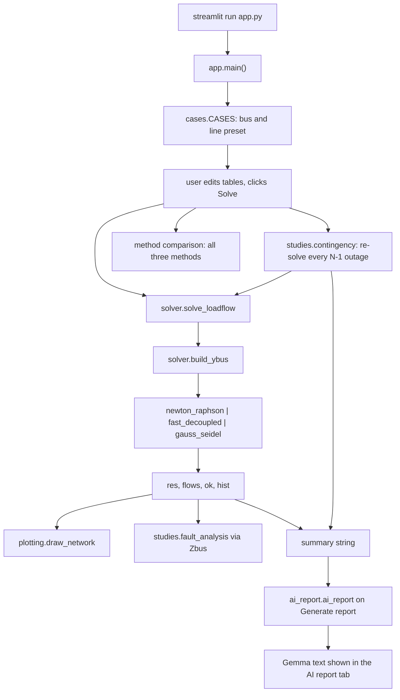

# CAPSA — Power System Analysis

A Python tool that solves an N-bus power system and turns the results into something readable: load flow by three classical methods, an N-1 contingency sweep, a three-phase fault study, and plots plus a plain-English summary. It was built for Hacktoberfest and uses only open-source libraries and open-weight models: the solver does every calculation, and a local Gemma model served by LM Studio only explains the numbers it is given.

## Features

- Three load flow methods: Newton-Raphson, Fast Decoupled (XB), Gauss-Seidel.
- Two editable presets: 5-bus demo and IEEE 14-bus.
- N-1 contingency sweep: each line removed in turn, case re-solved, ranked worst-first.
- Three-phase fault analysis at every bus via the Zbus matrix.
- Network diagram coloured by bus voltage, plus voltage-profile and post-fault charts.
- Method comparison table (convergence, iterations, loss, minimum voltage).
- Optional report written by a local Gemma model via LM Studio, given only the solver's numbers.

## Project structure

```
CAPSA/
├── app.py                 Streamlit GUI: sidebar settings, editable tables, result tabs
├── solver.py              METHODS, build_ybus, injections, the three solvers, solve_loadflow
├── cases.py               _bus/_lines helpers and the CASES presets
├── studies.py             contingency (N-1) and fault_analysis (3-phase via Zbus)
├── plotting.py            draw_network: layout and voltage-coloured network diagram
├── ai_report.py           LMSTUDIO_URL, lm_models, ai_report (local Gemma via LM Studio)
├── check_refactor.py      asserts the split modules match power_flow_methods.py exactly
├── power_flow_methods.py  the original single-file version, kept as the comparison baseline
├── requirements.txt       numpy, pandas, matplotlib, streamlit, requests, pytest
├── run.sh                 convenience wrapper around streamlit run app.py
├── AGENTS.md              contributor notes and conventions
└── venv/                  local virtual environment (managed with uv)
```

## Execution flow

1. `streamlit run app.py` imports the modules and calls `main()` in `app.py`.
2. The sidebar fills the case selector from `CASES` (`cases.py`), the method selector from `METHODS` (`solver.py`), and the Base MVA and voltage-limit inputs. The bus and line tables are the selected preset's DataFrames built by `_bus` and `_lines` (`cases.py`).
3. Clicking **Solve** calls `solve_loadflow(bus, lines, method)` (`solver.py`). It builds the admittance matrix with `build_ybus`, flat-starts the PQ voltages, forms the P/Q setpoints, dispatches to `newton_raphson`, `fast_decoupled` or `gauss_seidel`, then computes bus injections and per-line flows. It returns `(res, flows, ok, hist)`.
4. The same click loops over all three methods for the comparison table, and calls `contingency(bus, lines, vmin, vmax)` (`studies.py`), which removes each line in turn and re-solves the case.
5. Results and a summary string (bus table, total loss in MW, voltage limits, worst three outages) are stored in `st.session_state["out"]`.
6. The tabs render: load flow tables and charts; the network diagram from `draw_network(res, lines, vmin, vmax)` (`plotting.py`); the N-1 table; the short-circuit tab calls `fault_analysis(bus, lines, res, xd, zf, base, kv)` (`studies.py`) with the Xd'', Zf and base kV inputs and plots post-fault voltages.
7. In the AI report tab, `lm_models()` (`ai_report.py`) lists the models loaded in LM Studio. **Generate report** calls `ai_report(summary, model)`, which posts the summary to the LM Studio chat endpoint; the model phrases the numbers, it does not compute them.



## Where to look when debugging

| Symptom | File |
| --- | --- |
| Wrong bus voltages, angles, flows or losses | `solver.py` (`build_ybus`, the method functions, `solve_loadflow`) |
| Convergence flag or iteration counts look off | `solver.py` (convergence history handling) |
| N-1 table wrong or full of FAILED rows | `studies.py` (`contingency`) |
| Fault currents or kA numbers wrong | `studies.py` (`fault_analysis`), base kV input in `app.py` |
| Diagram or voltage colours broken | `plotting.py` (`draw_network`) |
| Report fails, or no models listed | `ai_report.py` (`lm_models`, `ai_report`); check LM Studio on port 1234 |
| Layout, editors or tab content misbehave | `app.py` (`main`) |

## Setup and run

```
uv pip install -r requirements.txt      # or: pip install -r requirements.txt
./run.sh                                # or: streamlit run app.py
```

`run.sh` just runs `venv/bin/streamlit run app.py`, so it works without activating the virtual environment.

The AI report needs LM Studio: open the Developer tab, load a Gemma model, click Start Server (port 1234). `lm_models` reads the loaded models from that server, so no model id is hardcoded. LM Studio is only needed for the AI report tab — everything else runs without it.

## Data format

Everything is per unit on the Base MVA from the sidebar.

Bus table:

| Column | Meaning |
| --- | --- |
| `Type` | `Slack`, `PV` or `PQ` (exactly one Slack bus) |
| `V` | Voltage setpoint (Slack and PV), initial guess for PQ |
| `Pg`, `Qg` | Generator injection |
| `Pd`, `Qd` | Load |
| `Bs` | Shunt susceptance |

Line table:

| Column | Meaning |
| --- | --- |
| `From`, `To` | 1-based bus numbers |
| `R`, `X` | Series resistance and reactance |
| `B` | Total line charging susceptance, split B/2 at each end |
| `Tap` | Off-nominal tap ratio, 1 = none |

Results: `res` has `Bus`, `V (pu)`, `Angle (deg)`, `P_inj`, `Q_inj`; `flows` has `From`, `To`, `P_ij`, `Q_ij`, `P_ji`, `Q_ji`, `Loss_P`, `Loss_Q`. For `solve_loadflow`, `len(hist) - 1` is the iteration count.

## Testing

- `./venv/bin/python check_refactor.py` — the refactor check. It compares the moved function source text, the `CASES` tables, `build_ybus`, `solve_loadflow` for all three methods on both cases, `contingency` and `fault_analysis` against `power_flow_methods.py` and asserts they are exactly identical. Note: that baseline file is currently commented out from top to bottom, so the script stops at import until the original code is restored.
- `pytest` is listed in `requirements.txt` and installed, but the repository has no test files yet, so `pytest` currently collects nothing.

## Limitations

- No generator reactive-power limits and no PV-to-PQ switching when a PV bus hits its Q limit.
- Fault analysis uses a single base kV (`kv` input) for all buses, so the kA column is wrong on multi-voltage cases such as IEEE 14-bus.
- Newton-Raphson uses a central-difference numerical Jacobian, which is slower than an analytical one on large cases.
- Gauss-Seidel is called without the `tol` argument inside `solve_loadflow`, so it always runs with its own default tolerance and the method comparison is not exactly at one shared tolerance.

## License and credits

Placeholder: license TBD. Built with numpy, pandas, matplotlib and streamlit, with the AI report generated by a local Gemma model via LM Studio.
